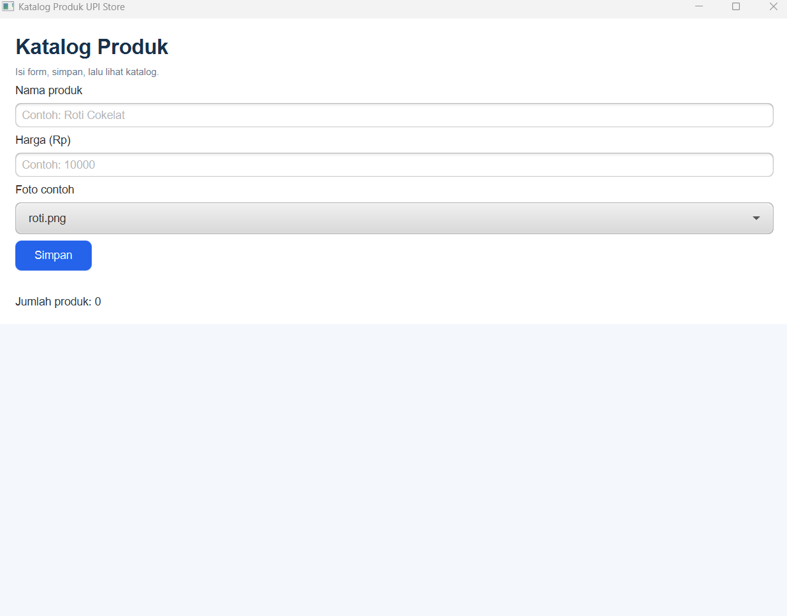
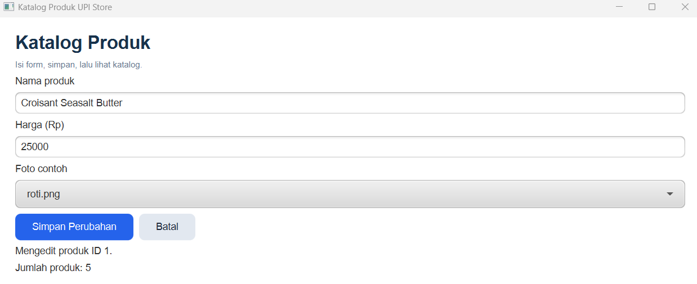
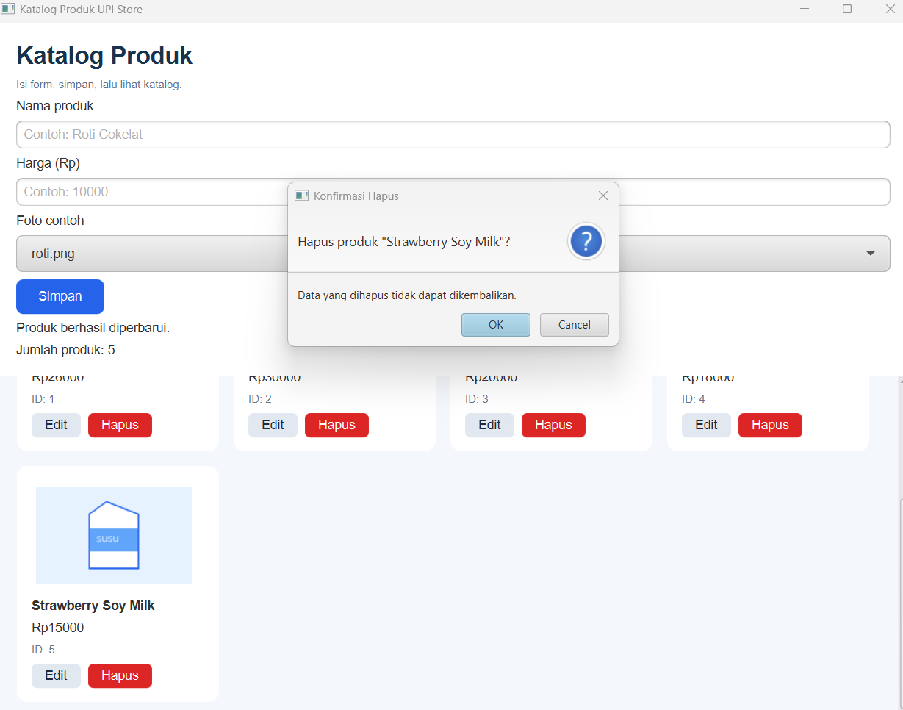
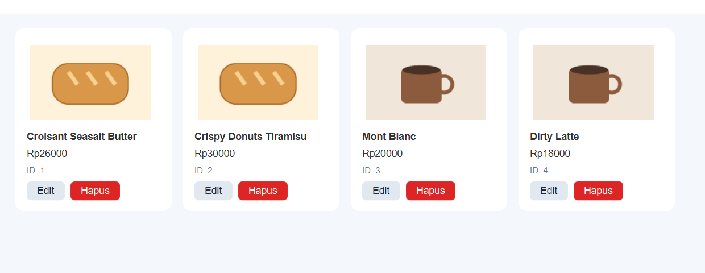

# 🛒 Katalog Produk

Aplikasi desktop untuk mengelola katalog produk, dibuat dengan **Java**, **JavaFX**, dan **SQLite** menggunakan prinsip **Pemrograman Berorientasi Objek (OOP)**. Pengguna dapat menambah, melihat, mengedit, dan menghapus produk yang ditampilkan dalam bentuk kartu (card).


---

## 📸 Tampilan Aplikasi

|                      Halaman Utama                      |                    Mode Edit                    |
| :-----------------------------------------------------: | :---------------------------------------------: |
|  |  |

|                       Konfirmasi Hapus                        |               Katalog dengan Banyak Produk                |
| :-----------------------------------------------------------: | :-------------------------------------------------------: |
|  |  |

---

## 🧰 Teknologi

- **Java 17**
- **JavaFX 21** (`javafx-controls`, `javafx-fxml`)
- **SQLite** melalui `sqlite-jdbc 3.49.1.0`
- **Maven** (build dan dependency management)
- **FXML + CSS** untuk UI

---

## 🗄️ Skema Database

```sql
CREATE TABLE IF NOT EXISTS produk (
    id    INTEGER PRIMARY KEY,
    nama  TEXT    NOT NULL CHECK(length(trim(nama)) > 0),
    harga INTEGER NOT NULL CHECK(harga > 0),
    foto  TEXT    NOT NULL CHECK(length(trim(foto)) > 0)
);
```

Tabel dan file `data/katalog.db` dibuat otomatis saat aplikasi pertama kali dijalankan, jadi tidak perlu setup database manual.

---

## 🚀 Cara Menjalankan

### Prasyarat

- [JDK 17](https://adoptium.net/) atau lebih baru
- [Apache Maven](https://maven.apache.org/download.cgi) 3.8+
- Git

Cek instalasi:

```bash
java -version
mvn -version
```

### Langkah

```bash
# 1. Clone repositori
git clone https://github.com/USERNAME/KatalogProduk.git

# 2. Masuk ke folder proyek
cd KatalogProduk

# 3. Jalankan aplikasi
mvn clean javafx:run
```

> **Penting:** jalankan perintah dari **folder utama proyek** (yang berisi `pom.xml`). Lokasi database dihitung dari folder tempat aplikasi dijalankan (`user.dir`), sehingga `data/katalog.db` akan dibuat di folder tersebut.

### Menjalankan lewat IDE (NetBeans / IntelliJ / VS Code)

1. Buka folder proyek sebagai **Maven Project**.
2. Tunggu Maven selesai mengunduh dependency.
3. Jalankan class `main.MainApp`, atau gunakan goal Maven `javafx:run`.

---

## 📖 Cara Penggunaan

1. **Menambah produk** — isi _Nama produk_, _Harga_, pilih _Foto contoh_, lalu klik **Simpan**.
2. **Mengedit produk** — klik **Edit** pada kartu produk. Ubah data pada form, lalu klik **Simpan Perubahan**. Klik **Batal** untuk membatalkan.
3. **Menghapus produk** — klik **Hapus** pada kartu, lalu pilih **OK** pada dialog konfirmasi.

---

## 🛠️ Troubleshooting

| Masalah                                    | Solusi                                                                                                                        |
| ------------------------------------------ | ----------------------------------------------------------------------------------------------------------------------------- |
| `JavaFX runtime components are missing`    | Jalankan dengan `mvn javafx:run`, bukan `java -jar` atau klik langsung class.                                                 |
| `No suitable driver found for jdbc:sqlite` | Jalankan `mvn clean install` agar dependency `sqlite-jdbc` terunduh ulang.                                                    |
| Gambar muncul "Gambar tidak tersedia"      | Pastikan file gambar ada di `src/main/resources/image/` dan namanya sesuai.                                                   |
| Data tidak muncul / database kosong        | Pastikan menjalankan dari folder utama proyek. Lihat log `DATABASE AKTIF:` di terminal untuk memastikan lokasi file database. |

---

## 👤 Pembuat

**`Wisam Anfaal Mahasin`**

---

## 📄 Lisensi

Proyek ini dibuat untuk keperluan akademik.
